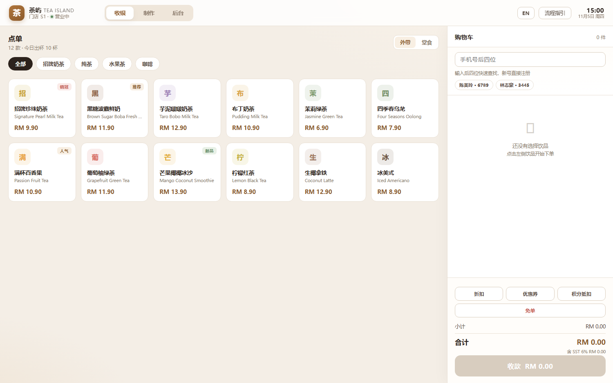

# 茶屿 TEA ISLAND · 门店运营系统（MVP1 原型）

一个可以在浏览器里真跑一遍的奶茶店运营系统：点单 → 客制化 → 收款（现金 / DuitNow / 储值）→ 小票 + 杯贴 → 制作看板 → 叫号取餐 → 后台看数。



---

## 运行

**方式一（最简单）**：双击 `index.html`，用 Chrome / Edge 打开。

**方式二（推荐，数据更稳）**：在目录内起一个静态服务器

```powershell
# 有 Python 就用这个
python -m http.server 8080
# 然后打开 http://localhost:8080
```

> 直接双击也能用，数据存在 localStorage。若浏览器限制本地文件存储，页面会提示「数据无法持久化」。

首次打开会自动生成 **7 天演示数据**（约 80 单），后台看板不会是空的。
「后台 → 设置 → 重置演示数据」可恢复初始状态。

---

## 走一遍完整流程（约 90 秒）

| 步骤 | 在界面上做什么 |
|---|---|
| 1 顾客点单 | 左侧点「招牌珍珠奶茶」→ 选大杯 / 半糖 / 少冰 / 加珍珠 → 加入购物车 |
| 2 员工下单 | 右侧购物车确认，可点「修改」换商品、改数量；点「折扣」可加折扣 |
| 3 收款 | 点「收款」→ 选现金（快速金额 / 输入实收，自动算找零）或 DuitNow（弹出二维码，点「模拟顾客已支付」） |
| 4 出单 | 自动弹出**客户小票**；点「查看杯贴」看每杯一张的 50×40 标签；同时已扣料、已发积分 |
| 5 制作 | 切到「制作」→ 待领取里点「领取工单」→ 逐杯勾选 → 全部勾完「完成制作」才会亮 |
| 6 叫号 | 完成即弹出叫号屏（带提示音）→ 顾客取走后点「已取餐」，订单结单 |

会员：在购物车上方输入手机号后四位（如 `6789`），或直接点下方的会员快捷标签。

---

## 已实现

| 模块 | 内容 |
|---|---|
| 收银 | 点单、客制化（杯型/糖度/冰量/加料/备注）、改单、数量增减、折扣、券、积分抵扣、免单（需原因）、现金/DuitNow/储值三种支付、找零、双语小票 |
| 菜单 | 12 款饮品、4 组选项、选项即价格（不建组合 SKU）、中英双语 |
| 制作 | 整单工单、领取、逐杯勾选、漏杯校验、重打杯贴、叫号屏 + 提示音、已取餐 |
| 库存 | BOM 自动扣料、杯型系数、安全库存、低库存提醒、损耗登记、库存价值 |
| 会员 | 手机号归一化检索、姓名选填、等级（4 级）、积分（赚/抵）、储值（充值赠送）、累计消费升级 |
| 后台 | 营业额/不含税/SST/毛利/毛利率/客单价、7 日趋势、热销榜、支付方式、渠道、订单列表 + 退单、库存、会员、审计 |
| 打印 | 客户小票（76mm 版式）、杯贴 50×40mm 预览 + 二维码（订单号+杯序） |

**计价**：标价含税，`税前 = round(合计 / 1.06)`，`税 = 合计 − 税前`（保证不差分）。金额全程用整数「分」。

---

## 演示场景（截图 / 培训用）

在地址后加参数可直接跳到某个状态：

```
index.html?scene=kds            三列都有工单的制作看板
index.html?scene=admin          后台概览
index.html?scene=admin&tab=stock
index.html?scene=admin&tab=orders
index.html?scene=admin&tab=members
index.html?scene=cust           打开客制化弹窗
index.html?scene=pay            购物车 + 会员 + 折扣 + 收款弹窗
index.html?scene=receipt        直接走完一单，展示小票
index.html?scene=labels         同上，展示杯贴
```

---

## 文件结构

```
milk-tea-ops/
├─ index.html
├─ assets/
│  ├─ styles.css        设计系统与全部样式
│  ├─ data.js           种子数据（菜单 / 配方 BOM / 库存 / 会员 / 券）
│  ├─ i18n.js           中英文案
│  ├─ store.js          领域逻辑：计价、税务、支付、库存、积分、状态机、报表
│  ├─ ui.js             外壳：路由、弹窗、提示、二维码、小票、杯贴、打印
│  ├─ view-pos.js       收银台
│  ├─ view-kds.js       制作看板
│  ├─ view-admin.js     后台
│  └─ boot.js           启动、语言切换、演示场景
├─ tests/
│  └─ logic.html        52 条领域逻辑自测（浏览器打开即跑）
└─ docs/
   └─ 技术方案.md        数据表 / 状态机 / 接口 / DuitNow / 对账 / 异常清单
```

---

## 与原型的差距（有意留白）

| 项 | 现状 | 说明 |
|---|---|---|
| DuitNow | 模拟二维码 + 模拟回调 | 真实接入需 PSP 账号，见技术方案 §7 |
| 打印 | 浏览器打印 / 预览 | 真实热敏与标签打印需本地 agent（ESC/POS + TSPL） |
| 外卖 | 只留字段与渠道概念 | 未接 Grab / Foodpanda |
| 换货 | 付款前可改单；付款后退单 | 付款后差额换货见技术方案 §14 |
| 离线 | 无 | 需要服务端 + 同步队列 |
| 权限 | 无 | 收银/制作/店长角色待做 |

设计决策与取舍写在 `docs/技术方案.md`，代码里的关键计算（含税拆分、BOM、积分）都有注释。
